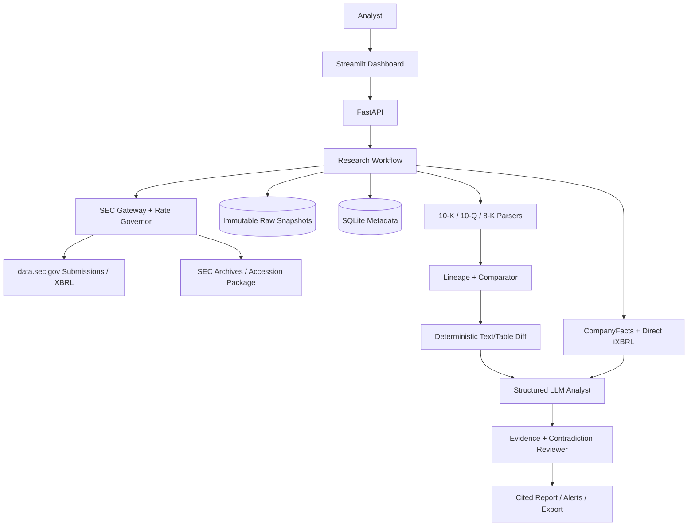
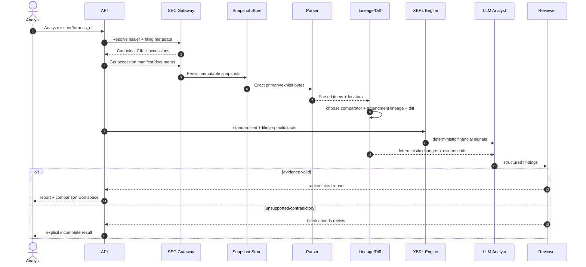
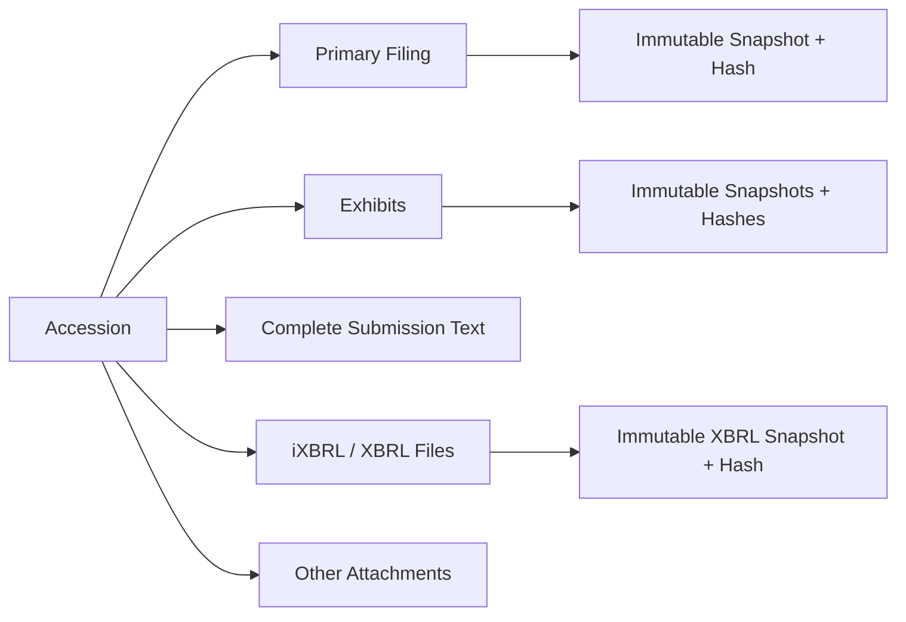
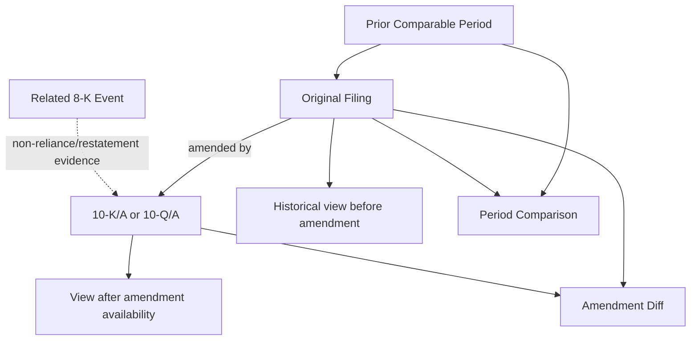
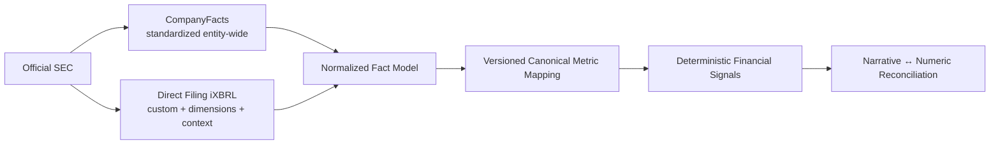
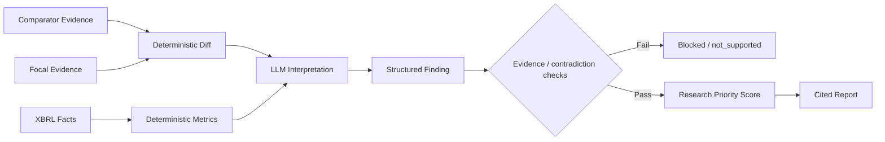
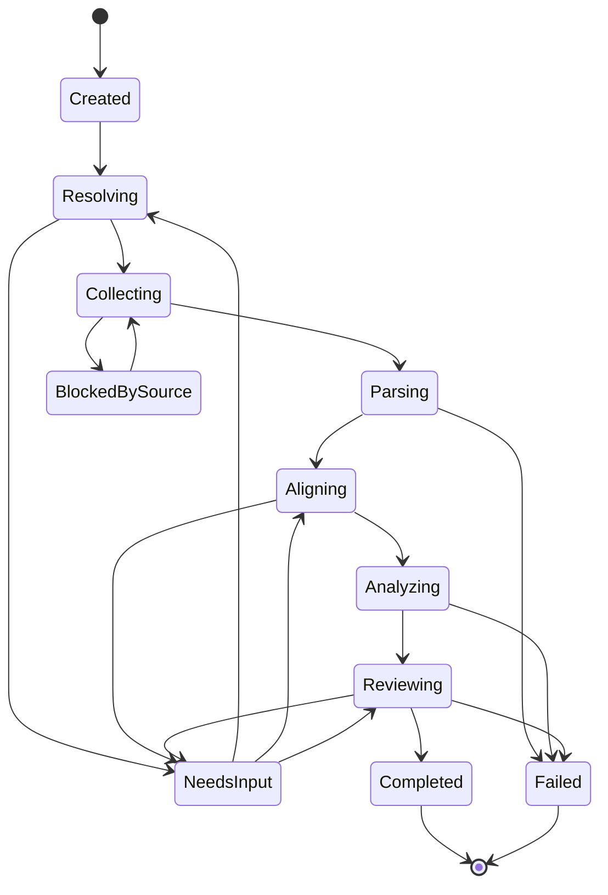
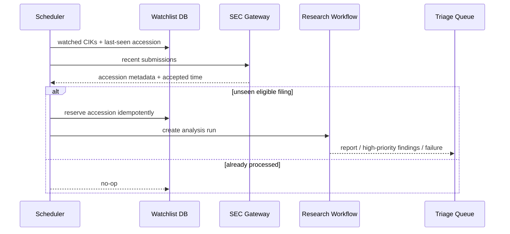

# FilingLens Diagrams

Mermaid diagrams for implementation and review.

## 1. System Architecture

## 2. End-to-End Research Run

## 3. Accession Package Model

## 4. Filing Lineage

## 5. XBRL Dual Path

## 6. Evidence-Backed Finding

## 7. Run State Machine

## 8. Watchlist Automation

